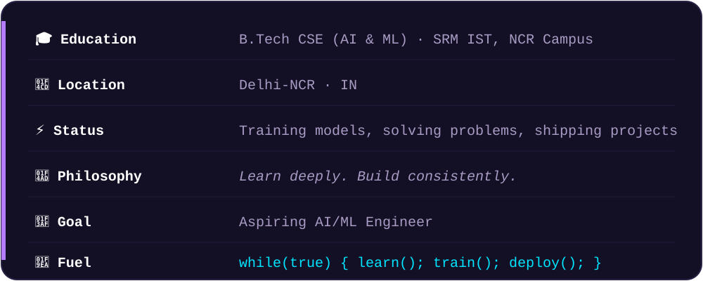

<div align="center">



<br/><br/>

`aditi@ai-lab:~$ whoami`

### Aditi Choudhary

<br/>

<a href="https://github.com/aditichoudhary9929"></a>
<a href="https://www.linkedin.com/in/aditi-choudhary2007/"></a>


</div>

<br/>

```text
+----------------------------------------------------+
|              ADITI-CHOUDHARY  v1.0-ml              |
+----------------------------------------------------+
| [ SYS ]  Loading identity modules ........ [ OK ]  |
| [ DATA]  Cleaning the dataset ............ [ OK ]  |
| [ AI  ]  Training neural networks ........ [ OK ]  |
| [ DSA ]  Optimizing with Dijkstra ........ [ OK ]  |
| [ BUG ]  Overfitting detected ............ [FAIL]  |
| [ GIT ]  git push origin main ............ [ OK ]  |
+----------------------------------------------------+
```

## 🧬 Identity



## 🛠️ Tech Arsenal

<div align="center">

**◆ LANGUAGES**<br/>


**◆ AI · ML · DATA**<br/>


**◆ TOOLS**<br/>


</div>

## 📡 Skills Loading...



## 🚀 Projects

| Project | Stack | What it is |
|---|---|---|
| **[srm-campus-route-planner](https://github.com/aditichoudhary9929/srm-campus-route-planner)** | C, Graphs, Web UI | SRM IST Delhi-NCR campus route planner and navigator: graph DSA engine with Dijkstra, Min-Heap, Trie autocomplete and an interactive web UI |

<!-- Add more rows as you build ML projects, for example:
| **[project-name](https://github.com/aditichoudhary9929/project-name)** | Python, scikit-learn | one-line description |
-->

## 📊 Metrics

<div align="center">


</div>

## 📈 Activity


<div align="center">

*Learn deeply. Build consistently.*

</div>
